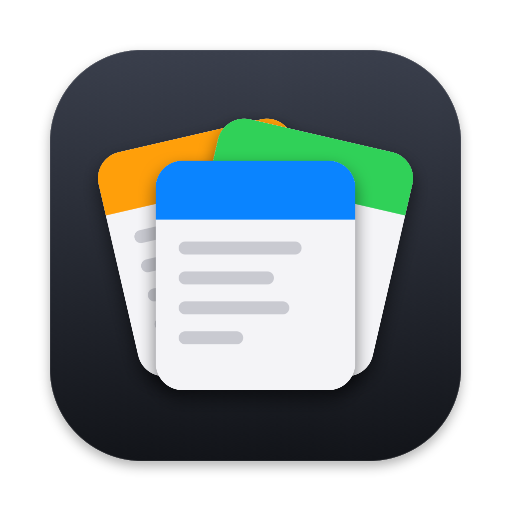

<p align="center">
  
</p>

<h1 align="center">OpenPaste</h1>

<p align="center">Менеджер буфера обмена для macOS. Нативный, на SwiftUI, без зависимостей.</p>

---

OpenPaste запоминает всё, что вы копируете: текст, ссылки, картинки, файлы. По `⇧⌘V` снизу экрана выезжает лента карточек. Выбираете нужную, нажимаете Enter, и она вставляется туда, где вы печатали.

## Возможности

- **История буфера**: текст, ссылки, картинки и файлы из Finder. Повторная копия не дублируется, а поднимается наверх.
- **Карточки с превью.** Шапка окрашена в цвет приложения, откуда скопировано, в подвале число символов, адрес ссылки или путь к файлу.
- **Пинборды**: закреплённые вкладки для того, что нужно часто. Свои названия и цвета, порядок меняется. Карточки в пинбордах не удаляются вместе с историей.
- **Поиск**: начните печатать, когда панель открыта.
- **Вставка в активное приложение**: Enter вставляет карточку туда, где был курсор. Файлы вставляются как файлы, а не как текст.
- **Liquid Glass** на macOS 26 и новее, матовая панель на более старых системах.
- **Срок хранения**: день, неделя, месяц (по умолчанию), год или бесконечно.
- **Приватность.** Всё хранится локально. Пароли из менеджеров паролей (помеченные `org.nspasteboard.ConcealedType`) не сохраняются.
- **Лёгкость.** Около 30 МБ памяти и ~0% CPU в фоне. Опрос буфера засыпает вместе с экраном.

## Установка

1. Скачайте `OpenPaste-vX.Y.Z.dmg` со страницы [Releases](../../releases).
2. Откройте образ и перетащите OpenPaste в «Программы». Приложение подписано и нотаризовано Apple, поэтому откроется без предупреждений.
3. Разрешите доступ в **Системные настройки → Конфиденциальность и безопасность → Универсальный доступ**. Без него OpenPaste только кладёт карточку в буфер, а вставлять нужно самому через `⌘V`.

Окна и иконки в Dock у приложения нет. Оно живёт в меню-баре (значок 📋).

## Управление

| Клавиши | Действие |
|---|---|
| `⇧⌘V` | Открыть / закрыть панель |
| `←` `→` | Выбрать карточку |
| `Enter` или двойной клик | Вставить в активное приложение |
| `⌘←` `⌘→` | Переключить вкладку: история ↔ пинборды |
| `⌘1` … `⌘9` | Закрепить карточку в пинборд с этим номером |
| `⌫` | Удалить карточку, когда поиск пустой |
| `⌘⌫` | Очистить поиск, а если он пустой — удалить карточку |
| `⌘Z` | Вернуть последнюю удалённую карточку |
| Любые буквы | Поиск |
| `Esc` | Закрыть панель |

**Мышью:**
- карточку можно перетащить на вкладку пинборда или в другое приложение;
- правый клик по карточке открывает меню «Вставить / Переименовать / Закрепить в / Удалить»;
- двойной клик по названию пинборда переименовывает его;
- правый клик по пинборду открывает меню: переименовать, сдвинуть, удалить, выбрать цвет.

Настройки открываются из меню-бара: «Настройки…» или `⌘,`.

## Сборка из исходников

Нужны macOS 14+ и Xcode 26 или новее: для Liquid Glass требуется SDK macOS 26.

```sh
git clone https://github.com/Airumian/openPaste.git
cd openPaste
./build.sh && open OpenPaste.app
```

| Команда | Что делает |
|---|---|
| `./build.sh` | Собирает `OpenPaste.app` |
| `./dmg.sh` | Упаковывает приложение в `OpenPaste.dmg` |
| `swift test` | Запускает тесты |
| `OPENPASTE_BENCH=1 swift test -c release --filter Benchmark` | Замеряет скорость на большой истории |
| `swift icon/make-icon.swift` | Перерисовывает иконку |
| `open Package.swift` | Открывает проект в Xcode |

`build.sh` подписывает приложение вашим сертификатом «Apple Development» или «Developer ID», если он есть в связке ключей. Тогда разрешение Универсального доступа сохраняется между сборками. Без сертификата используется подпись ad-hoc, и после каждой сборки разрешение придётся выдавать заново. Нужный сертификат можно указать явно: `SIGN_IDENTITY="..." ./build.sh`.

Если запускать через `swift run` или Run в Xcode, вставка работать не будет: разрешение достанется Терминалу или Xcode, а не OpenPaste.

## Релизы

Релизы выпускает сопровождающий проекта на своём Mac одной командой:

```sh
./release.sh v0.2.0
```

Скрипт:
1. прогоняет тесты;
2. собирает приложение и DMG;
3. подписывает их сертификатом Developer ID и отправляет на нотаризацию в Apple;
4. ставит тег и публикует DMG в Releases.

Сертификат хранится только в связке ключей сопровождающего и в GitHub не загружается. Версия приложения берётся из тега.

На каждый push и pull request GitHub Actions проверяет, что проект собирается и тесты проходят.

## Как устроено

```
Sources/OpenPaste/
├── OpenPasteApp.swift     # точка входа, меню-бар, окно настроек
├── ClipStore.swift        # история и пинборды: опрос буфера, хранение, поиск, срок хранения
├── PanelController.swift  # окно панели и клавиатура
├── PanelView.swift        # интерфейс панели и карточек
├── SettingsView.swift     # настройки
├── AppStyle.swift         # иконки и цвета приложений, форматирование подписей
├── Glass.swift            # Liquid Glass с запасным вариантом для старых macOS
└── System.swift           # глобальный хоткей и эмуляция ⌘V
```

- **Отслеживание буфера.** В macOS нет события «буфер изменился», поэтому OpenPaste раз в 0,4 с проверяет `NSPasteboard.changeCount`. Так же делают и другие менеджеры буфера. При бездействии проверка реже, на блокировке экрана — пауза.
- **Вставка.** Карточка кладётся в буфер, затем эмулируется `⌘V`. Для этого и нужен Универсальный доступ.
- **Хранение.** Всё лежит в `~/Library/Application Support/OpenPaste/`:
  - история в `history.json`;
  - картинки и их превью в `images/`;
  - тексты больше 50 КБ в `texts/`.

  Запись на диск идёт в фоне и не чаще раза в полсекунды.

## Лицензия

© 2026 Alexander Airumian. Проект распространяется под лицензией [CC BY-NC 4.0](LICENSE) (Creative Commons «С указанием авторства — Некоммерческая»).

**Можно:**
- использовать, копировать и изменять код;
- распространять его и свои доработки.

**Условия:**
- **указывайте автора**: имя и ссылку на этот репозиторий и лицензию;
- **только некоммерческое использование.** Для коммерческого использования нужно письменное разрешение автора.
